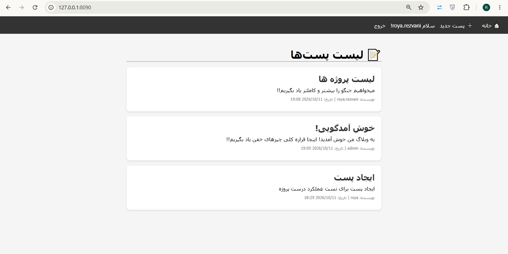
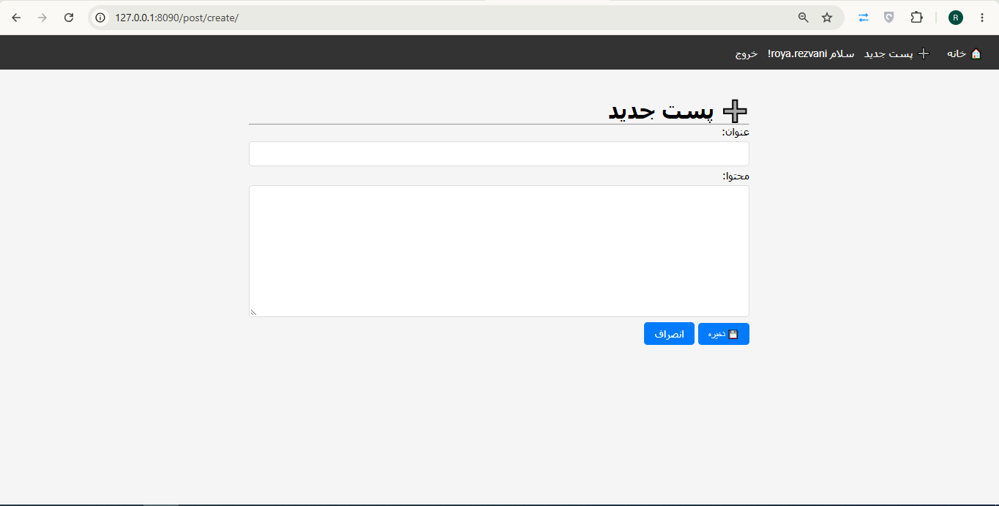
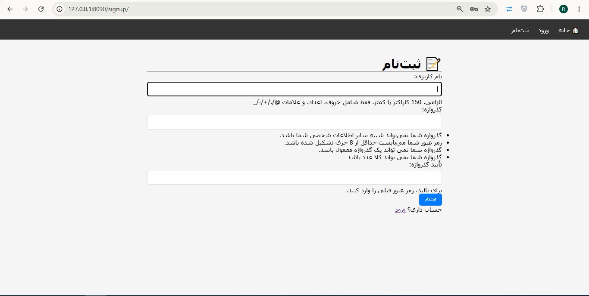
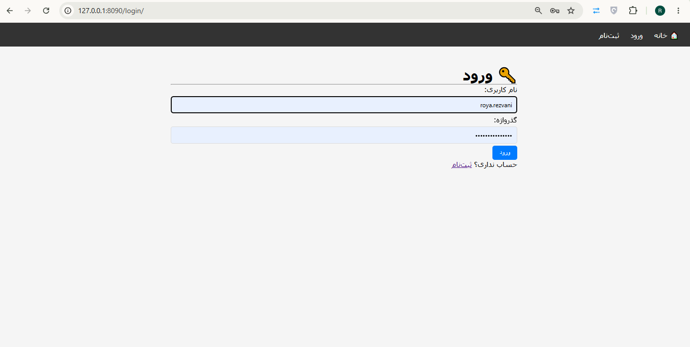

# 📝 وبلاگ با Django

یک وبلاگ ساده با CRUD کامل و احراز هویت.

## ✨ امکانات
- 📝 ثبت‌نام، ورود، خروج
- ➕ ساخت پست (فقط کاربران لاگین‌شده)
- 📖 لیست و جزئیات پست‌ها
- ✏️ ویرایش پست (فقط نویسنده)
- 🗑 حذف پست (فقط نویسنده)
- 🎨 رابط کاربری RTL

## 📸 اسکرین‌شات‌ها

### لیست پست‌ها

### ساخت پست

### ثبت‌نام

### ورود

## 🛠️ تکنولوژی‌ها
- Python 3
- Django 5.0+
- SQLite

## 🚀 نصب و اجرا
...

## 👤 نویسنده
[@royarezvani](https://github.com/royarezvani)